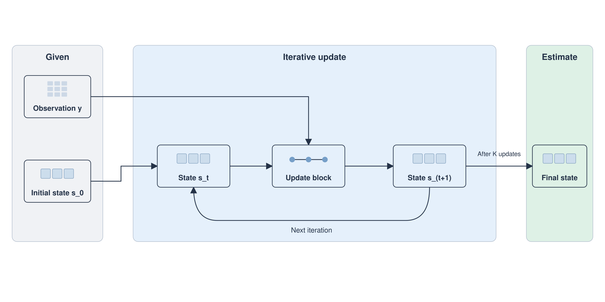

# Paper Visual Schema

**把论文逻辑变成绘图模型能执行的物理蓝图。**

一个可直接安装的论文方法图 skill，也是一套可单独复制的 **Architect → Renderer** 提示词。先明确模块、分支、训练/推理和反馈关系，再描述容器、网格、坐标、箭头与标签。无需 API Key；Python 工具仅使用标准库。

```text
论文摘要 / 方法章节
        ↓ The Architect
visual-schema.json  ← 原文依据 + 计算关系 + 具体几何
        ↓ 本地校验与编译（可选）
renderer-prompt.md
        ↓ The Renderer / 矢量绘图工具
图片草稿 / 可编辑方法图 → 人工检查语义与文字
```



*上图是虚构迭代方法的可编辑 SVG 示例，按蓝图手工构建；不是 Nano-Banana Pro 的生成效果，也不是实验结果。*

## 直接用：两段提示词

1. 复制 [Architect 提示词](prompts/architect.md)，在末尾附上论文内容与尺寸要求。它输出带原文依据的 JSON 蓝图。
2. 复制 [Renderer 提示词](prompts/renderer.md)，粘贴第一步的 JSON，交给你选定的绘图模型。Nano-Banana Pro 可作为渲染端；本仓库不调用或绑定它。
3. 对照原文检查箭头、分支、训练/推理边界和每个字符。需要准确文字或可编辑图时，用矢量工具排字并重建关键连线。

纯提示词用法不需要安装 skill 或运行脚本。示例方法、蓝图与编译结果见 [examples](examples/README.md)。

## 作为 skill 安装

按当前 [Codex 官方 skill 文档](https://developers.openai.com/codex/skills/)，可放入用户级 `.agents/skills`，或项目的 `.agents/skills`。以下命令要求目标目录尚不存在，不覆盖已有安装：

```bash
mkdir -p "$HOME/.agents/skills"
git clone https://github.com/huzhongyyuan/paper-visual-schema.git \
  "$HOME/.agents/skills/paper-visual-schema"
```

已使用 `~/.codex/skills` 的宿主可按其现有发现路径安装；同一宿主保留一份，避免同名条目。仓库根目录就是 skill，`SKILL.md` 不依赖作者本机路径或其他私有 skill。

调用示例：

```text
使用 $paper-visual-schema，把下面的方法画成双栏论文的框架图。
先交付可检查的蓝图和渲染提示词；图中文字用英文。
[粘贴方法章节]
```

skill 支持隐式选择；不会自行更改模型、provider、认证或开启外部绘图服务。实际渲染需要宿主具备相应工具。

## 可选：检查和编译蓝图

要求 Python 3.10+，无第三方 Python 依赖。从仓库目录运行：

```bash
python3 scripts/schema_tool.py validate examples/dual-stream/visual-schema.json
python3 scripts/schema_tool.py compile examples/dual-stream/visual-schema.json \
  --output renderer-prompt.md
python3 -m unittest discover -s tests -v
```

编译器将唯一 JSON 源转成可直接粘贴的完整 Renderer 提示词，保留 `---BEGIN PROMPT---`、`[VISUAL SCHEMA]`、`[LAYOUT CONFIGURATION]`、分区和连接描述；原文摘录不会进入编译后的绘图提示词。

检查包括：重复 ID/JSON 键、丢失引用、未使用标签、区域越界、节点容纳、训练/推理阶段冲突和缺少返回路径的反馈箭头。错误以非零状态退出。检查器不判断科学语义是否正确，也不检测最终画面的碰撞和错字。完整字段见 [schema contract](references/schema.md)，实际检查范围见 [validation](VALIDATION.md)。

## 相比原始两阶段模板

| 原模板的易错点 | 本版处理 |
| --- | --- |
| “严格二维”与“等距透视”并存 | 统一为平面二维；风格与几何互不冲突 |
| 仅按抽象概念描述模块 | 每个节点给出物体、容器、内部结构和全局坐标 |
| 把优化或并行分支画成推理闭环 | 节点/箭头分别记录类型、阶段和原文依据 |
| 箭头文字与 `Input/Output` 规则冲突 | 所有可见文字共用白名单，按引用定位 |
| 模型补出熟悉但不存在的模块 | 每条计算关系对应提供材料中的摘录；缺失关键关系先问清 |
| 把 prompt、有效 JSON 或位图当成最终论文图 | 分别报告结构校验、语义核对、渲染和图像检查 |

`label_mode: deferred` 支持先生成无字图形，再单独排字；这类中间图仍需补齐标签。坐标和导出像素是请求约束，实际尺寸取决于渲染工具。精确拓扑和文字应由可编辑图形或矢量叠加保留。

## English quick start

Turn an abstract or method into an evidence-linked physical blueprint, then pass it to your chosen renderer. Use the [Architect](prompts/architect.md) and [Renderer](prompts/renderer.md) prompts independently, or install the repository as an agent skill. A zero-dependency Python CLI validates the blueprint and compiles the original Markdown-style handoff.

Layouts include pipelines, actual iterative loops, hierarchies, parallel streams, hubs and justified hybrids. One exact text whitelist covers nodes, arrows and headings. Training/inference semantics remain explicit. Sources are retained in JSON and omitted from compiled renderer prompts.

This is a prompt/skill toolkit, not a model integration or a measured image-generation benchmark. Numerical figures need real data; empirical examples need real outputs. Both bundled methods are fictional. The SVG preview is an editable reference constructed from the iterative blueprint. No image-model generation is claimed.

## Contributing and license

For a schema change, include a minimal supported method, its blueprint, and a counterexample demonstrating the failure. Run the tests and recompile changed examples. An optional [GitHub Actions template](ci/github-actions.example.yml) checks Python 3.10, 3.12 and 3.14; maintainers can enable it by copying it into `.github/workflows/check.yml` with suitable GitHub permissions. It is not enabled in this initial release. For a proposed model-quality improvement, include the actual renderer/version, prompt, image and observed failure; do not infer quality from a validator pass. Exclude unpublished papers or private assets unless they are cleared for redistribution.

The two-stage Architect → Renderer workflow was supplied in the repository owner's creation request. This release adds the versioned contract, checks, examples and agent packaging; it does not establish priority over other two-stage drawing workflows. All bundled examples and artwork were created for this repository. [MIT](LICENSE).
